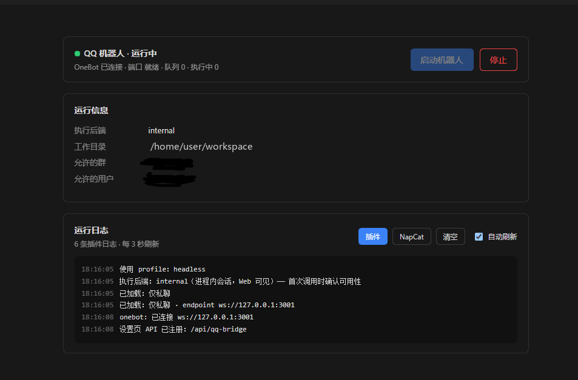

# dsh-qq-bridge

**中文** | [English](README.en.md)

用 **QQ 私聊远程驱动 [DeepSeek Harness](https://github.com/deepseek-ai)**。

手机上给机器人发一句话，家里/公司的电脑就真的开始干活 —— 会话直接在 DSH 进程内创建，
所以你在 Web 界面里能看着它跑，也能随时接管过来继续打字。

<!-- 截图：把 PNG 放到 docs/ 下即可自动显示，详见 docs/SCREENSHOTS.md -->
<p align="center">
  
  &nbsp;&nbsp;&nbsp;
  
</p>

<p align="center">
  <sub>左边：在 QQ 里发一句话 &nbsp;|&nbsp; 右边：DSH 设置里的控制面板</sub>
</p>

```
QQ 消息（默认仅私聊）
   ↓  NapCat（电脑上已登录的 QQ）
   ↓  OneBot 11 WebSocket
dsh-qq-bridge（DSH 插件）
   ↓  ctx.agents.create() —— 在 DSH 进程内建会话
结果 + 产物 → 切分 → 发回 QQ
```

## 特性

- **无冷启动**：会话建在当前 DSH 进程里，不像 `dsh headless` 每次都要等十几秒
- **Web 里可见可接管**：QQ 开的会话会出现在 DSH 侧边栏，能围观也能接着聊
- **图片/文件双向**：发给它会被下载到 `inbox/` 供模型读取；它的产物自动发回 QQ
- **即时回执**：收到消息 0.2 秒内回一句「收到，正在处理…」，之后按 3 秒节奏报进度
- **设置页控制**：在 DSH 设置里一键启停 NapCat、看状态和日志，不用碰命令行
- **仅私聊模式**：`privateOnly: true` 时群里完全静默，避免误触发

## 快速开始

```bash
dsh plugin add https://github.com/xhuyangx1/dsh-qq-bridge
```

三步跑起来：

1. **装并登录 NapCat**（让 QQ 暴露 OneBot 11 接口）
   → [NapCat 官方文档](https://napcat.napneko.icu/)
2. **配置白名单**：编辑 profile 层的 `cordis.patch.yml`，至少填 `allowedUsers`（你的 QQ 号），
   然后把 `disabled` 改成 `false`
3. 重启 DSH

> 详细的 NapCat 配置、安装排错见下面的 [完整安装](#完整安装)。

```yaml
- id: qq-bridge
  name: 'dsh-qq-bridge'
  disabled: false
  config:
    privateOnly: true
    allowedUsers:
      - 你的QQ号
    napcat:
      dir: 'C:\\path\\to\\NapCat'
```

## 安全提示

> ⚠️ **这个插件本质上是「把电脑的执行权接到 QQ 上」。**
>
> - 必须填 `allowedUsers`，否则任何能私聊到机器人的人都能驱动你的机器
> - 默认 `privateOnly: true`，群聊需要显式打开
> - 机器人跑在 DSH 的权限范围内，请确认你清楚模型可能执行哪些操作
> - 不要把这个机器人拉进公开群

## 仅私聊模式（默认开启）

```yaml
privateOnly: true
```

开了之后**群里发什么都不处理**，只响应私聊。

> ⚠️ **不要用「allowedGroups 留空」来实现只私聊。**
> 那个配置的语义是「空 = 不限制任何群」，清空反而会放开**所有**群。
> 必须用 `privateOnly: true` 显式拦。

实测：群消息零响应，私聊 0.2 秒出回执。

## 命令

| 命令 | 作用 |
| --- | --- |
| `/dsh <任务>` | 在电脑上执行，结果发回 |
| `/dsh stop` | 打断本群正在跑的任务 |
| `/dsh ping` | 探活 + 队列状态 |
| `/dsh new [名]` | 开新会话（清空上下文）|
| `/dsh list` | 列出历史会话 |
| `/dsh switch <n>` | 切到第 n 个会话 |
| `/dsh current` | 显示当前会话和工作目录 |
| `/dsh dir` | 查看工作目录 |
| `/dsh dir <路径>` | 切换工作目录 |
| `/dsh dir -` | 回到上一个目录 |

**私聊不需要前缀**，直接说话即可（仍受 `allowedUsers` 白名单限制）。

## 执行后端：三种模式

插件支持三种执行后端，用 `backend` 选择：

| | `internal`（推荐） | `acp` | `headless` |
| --- | --- | --- | --- |
| 形态 | **DSH 进程内建会话** | 常驻子进程 | 每次 spawn |
| 冷启动 | **无** | 首轮 5–10 秒 | 13–17 秒 |
| **Web 里可见** | ✅ **能围观、能接管** | ❌ | ❌ |
| 适用 | 日常首选 | internal 不可用时 | 兜底 |

回退链：`internal` → `acp` → `headless`，任一环不可用自动降级。

### internal 模式的原理

直接在跑着的 DSH 进程里调 `ctx.agents.create()`，
创建的会话和你在 Web 里手动开的是**同一种东西**：

- 出现在 DSH Web 左侧会话列表
- 能实时看它怎么回
- **可以直接在 Web 里接着打字**，QQ 和 Web 是同一个会话

五个必须注意的点（都是实测踩出来的，照抄能省几十小时）：

```js
// 1. 参数是 sessionId，不是 id
agents.create({ sessionId, meta: { cwd }, agentOptions })

// 2. 必须传 agentOptions，否则提示词里 {{model}} 为空，
//    回合直接以 error 结束：
//    'prompt variable "{{model}}" has no value for this assembly'
const selection = defaultModel.currentSelection()
const agentOptions = { provider: selection.provider, model: selection.model }

// 3. 服务要延迟获取 —— apply() 时 agents/sessions 还没挂上来

// 4. 必须装 agent preset，否则会话是空壳、没有任何工具！
//    症状：模型回「当前会话没有 read / read_image 这类文件读取工具可用」
//    修法（照抄 dsh-api-session-controller 的 composeAgent）：
const resolved = await ctx.get('agentPresets').resolve()
setup = async (agentCtx) => { await ctx.get('agentPresets').mount(agentCtx, resolved.id) }
agents.create({ sessionId, meta: { cwd, agentPreset: resolved.id }, agentOptions, setup })
```

第五个坑（**最严重，会导致历史对话打不开**）：

```js
// 错：手搓裸对象投递，写进日志没有 id
agent.followup({ role: 'user', content: [...], source: {...} })
// 重载该会话时报：
//   session event at seq N lacks an identified message (gateway/internal)
//   结果是整个历史对话加载失败

// 对：用 DSH 官方工厂，它会补稳定 id 并 freeze
import { createUserMessage } from '@deepseek-ai/dsh-llm'
agent.followup(createUserMessage({
  content: [{ type: 'text', text }],
  source: { kind: 'user', rpcId: randomUUID() },
}))
```

取不到该工厂时，兜底手搓也必须自带 `id: randomUUID()`。

回复从 `session.snapshotEvents()` 取 `assistant/message` 的 text 分片，
用 `await agent.whenIdle()` 等这一轮跑完（比轮询稳）。
## 收到消息后立刻回执

模型要跑几秒到几十秒，所以插件**收到消息的瞬间**先回一句：

```
收到，正在处理…（告诉我现在是几点）
```

实测：**发送 → 看到回执 0.8 秒**。

几个细节：

- 回执在**入队时**发，不等排队。前面还有任务时回「已排队，前面还有任务…」；
- 图片/文件先回「收到 N 个文件，正在下载…」，再去下载；
- 之后超过 `progress.startAfterMs`（默认 **3 秒**）的任务继续报进度。

> 为什么值得：之前默认 8 秒才报进度、且没有回执，前面那段完全静默，
> 用户没法判断消息到底发出去没有 —— 尤其模型慢的时候。

关掉用 `ackOnReceive: false`。

### 执行进度

长任务执行中，群里会收到这样的进度消息：

```
⏳ 进行中 24s · 第 3 步
▸ 终端 pnpm test --filter core ✓
▸ 读文件 /src/index.ts ✓
▸ 搜内容 ×4 route ✓
… 先确认依赖版本有没有被改动
```

四条约束避免刷屏：

| 键 | 默认 | 含义 |
| --- | --- | --- |
| `progress.enabled` | `true` | 关掉就只有最终答案 |
| `progress.startAfterMs` | `3000` | **快于此耗时的任务一条进度都不发**，跑完直接给答案 |
| `progress.minIntervalMs` | `5000` | 两次进度的最小间隔，期间事件合并 |
| `progress.maxMessages` | `12` | 单任务进度条数上限 |

**只在工具切换时报告**：同一个工具连着调用好几次（比如连续 `grep` 四次），
不会刷四条，只合成一条 `▸ 搜内容 ×4`。换工具、或者中间插了别的动作，才会新起一行。

觉得吵就把 `minIntervalMs` 调到 15000，或直接 `enabled: false`。

**同一个聊天共用一个 DSH 会话**，所以上下文是连续的：上一条让它读的文件，下一条可以接着问。
想每次都开新会话，把 `perGroupSession` 设成 `false`，或者发 `/dsh new`。

## 多模态：图片与文件

发图片或文件给机器人，插件会自动：

1. 下载到 `<cwd>/inbox/<时间戳>-<短id>.<ext>`
2. 把路径拼进任务，交给模型用 `read_image` / `read` 读取
3. 回一句「收到 N 个文件，正在处理…」

> 为什么是「落地 + 引用」而不是直接把二进制喂给模型：
> `dsh headless` 只接受文本参数，没有任何 `--image` / `--file` 入口。
> 实测模型能正确读取本地图片并描述内容。

## 附件回传

回答里出现下面这几种**独占一行**的写法，插件会把文件真的发到 QQ：

```
**[学习机资源合集.xlsx](inbox/xxx.xlsx)**     ← markdown 链接
附件: /path/to/chart.png                   ← 显式标记
- [reel.mp4](reels/out/reel.mp4)            ← 列表项里的链接
```

相对路径会按 `cwd` 解析；文件必须真实存在。

### 为什么只认「独占一行」

早期版本见到路径就发，结果出现两个真实问题：

1. 回答里**讨论**到某个文件（「原始文件保留在 inbox/xxx.xlsx 没改动」）也被当成交付，
   同一个文件发两遍；
2. 上下文里提到过的无关文件一起被发出去。

现在行内顺带提到的路径一律不发，只有明确排版成链接/标记的才算交付物。
要关掉用 `sendAttachments: false`。

## 会话与上下文

- **同群共享一个会话**，上下文连续；私聊按人隔离；
- **空闲自动重置**：超过 `resetOnIdleMins`（默认 180 分钟）没说话，自动开新会话。
  这是为了防止「上下文漂移」——一次失败的调试会灌进几十条无关日志，之后再问什么都在这堆噪声里找答案；
- 想立刻清空上下文用 `/dsh new`。

## 为什么是 NapCat 而不是官方 QQ 机器人

官方 QQ 机器人开放平台给的是 `group_openid`，**不是群号**，而且沙箱里主动发消息要单独申请权限。
普通群只能走本地协议端（NapCat / Lagrange），它复用你电脑上已登录的 QQ，
不需要公网 IP、不需要备案、不需要审核。

> 代价：协议端属于非官方接入，存在被风控的理论风险。插件本身不碰 QQ 账号，只跟 OneBot 讲话；
> 想换协议端（Lagrange 等）改 `onebot.endpoint` 即可。

## 完整安装

### 1. 电脑装 NapCat

装 NapCatQQ，登录你那个 QQ，然后在它的「网络配置」里开 **WebSocket 服务器**：

| 项 | 值 |
| --- | --- |
| 主机 | `127.0.0.1` |
| 端口 | `3001` |
| Token | 可留空；填了就把同样的值写进插件配置 |

或者反过来用「WebSocket 客户端」让 NapCat 连到插件——本插件目前是**主动连 NapCat**，
所以用「WebSocket 服务器」模式最省事。

### 2. 装插件

**注意：`name` 必须指向 `lib/index.js`，不能指向目录。** DSH 用原生 ESM 加载插件，
目录导入会直接报 `ERR_UNSUPPORTED_DIR_IMPORT`，插件起不来。

```bash
dsh plugin --profile web add /path/to/dsh-qq-bridge
```

装完确认 profile 的 `node_modules` 里能解析到这个包名：

```bash
ls ~/.dsh/profiles/web/node_modules/dsh-qq-bridge
# Windows:  dir %DSH_HOME%\profiles\web\node_modules\dsh-qq-bridge
# Linux:    ls ~/.dsh/profiles/web/node_modules/dsh-qq-bridge
```

没有就手动建一个链接（Windows 用 `mklink /J`，或直接把目录拷进去）。
用包名 `dsh-qq-bridge` 时 Node 会顺着 `package.json` 的 `exports` 找到 `lib/index.js`，
所以这条路比写绝对路径更稳。

### 3. 打开并配置

插件在 `cordis.patch.yml` 里默认 `disabled: true`（**故意不默认开启**，见下面的安全一节）。
在你 profile 层的 `cordis.patch.yml` 追加覆盖：

```yaml
- id: qq-bridge
  disabled: false
  config:
    allowedGroups:
      - 100000001
    onebot:
      endpoint: 'ws://127.0.0.1:3001'
      accessToken: ''
    # 跑任务用哪个 profile —— 必填，模型和凭据都在里面
    command:
      profile: web
    cwd: 'C:\Users\你的用户名\项目目录'
```

重启 DSH 后，在群里发：

```
/dsh ping
```

收到 `pong · 队列 0 · 执行中 0/2 · 会话 未建立` 就通了。启动日志里应该有两行：

```
[qq-bridge] headless 调用形态：NDJSON（0.1.7+）
[qq-bridge] 使用 profile：web
```

### 版本差异（踩过的坑）

插件的执行后端是 `dsh headless`，但**这两个 dsh 版本的 headless 完全不是一套 CLI**：

| | dsh ≤ 0.1.5 | dsh ≥ 0.1.7 |
| --- | --- | --- |
| `--json` | ❌ 报 `unknown option` | ✅ NDJSON 事件流 |
| `--session-id` | ❌ 不支持 | ✅ 续接会话 |
| `-` 读 stdin | ❌ 不支持 | ✅ 支持 |
| 任务传法 | 位置参数 | 位置参数或 stdin |
| 答案 | stdout 纯文本 | NDJSON 里的 `final` |

插件启动时会跑一次 `dsh headless --help` **自动探测**，两种都兼容：

- 探测到 `--json` → 用 `--profile X --json -`，任务走 stdin，能拿到
  `tool_call` / `tool_result` 事件，**群里才有进度**；
- 否则 → 用 `--profile X "<任务>"`，把 stdout 全文当答案，**没有进度**（旧版不吐事件）。

想强制指定就写 `command.mode: 'json'` 或 `'plain'`。

> **参数拼接有个坑**（曾经真实踩到）：`--profile` 是用来「选 profile」的，
> 它后面**不应该再跟一个 `headless`**。写成 `--profile headless headless --json -` 时，
> 第二个 `headless` 会被当成任务参数，dsh 直接报
> `` `-` must be the only task argument ``。正确形式是两段分开：
> 选择段 `--profile X` + 应用段 `--json -`。
> 只有**不指定 profile** 时才用 `dsh headless ...` 这种快捷子命令。

> Windows 上还有两个平台坑，代码里已经处理，遇到时知道原理即可：
> `dsh` 是 `dsh.cmd` 垫片，Node 的 `spawn` 不会补扩展名（ENOENT），
> 而且从 Node 18.20 起不把批处理交给 shell 会直接 EINVAL——插件会先按 `PATHEXT` 把路径解析全，
> 再对 `.cmd/.bat` 自动加 `shell: true`。

### 前置：headless profile 必须先能跑通

插件只是壳，真正干活的是 `dsh --profile headless "<任务>"`。**先手动验证这一条能出结果**：

```bash
dsh --profile headless "只回复两个字：收到"
```

如果它报下面两类错，插件这边怎么配都没用，要先修 profile：

| 报错 | 真实原因 | 修法 |
| --- | --- | --- |
| `The requested module './sse.js' does not provide an export named 'reasoningLoopFailure'` | `dsh-codearts-auth` 里 `sse.js` 已被升级、`llm-adapter.js` 还是旧版，属于**半套升级** | 用同版本完整包覆盖该目录 |
| `buddy: no usable credential` / `未配置凭据` | 账号索引在 `$DSH_HOME/jet-hub/state.json`，但插件在 0.1.5/0.1.6 上优先走了 settings 后端，而 `settings.yaml` 里没有 `jet-hub:` 段 ⇒ 账号列表恒为空 | 见下 |

第二类特别隐蔽：**它看起来是"时好时坏"**，因为 token 状态不同会走到不同分支。实测 8 次里有 5 次失败。
判定方法是看 `AccountPool` 拿到的账号数——为 0 就是这个问题。

根因是 `createJetHubStore()` 只判断 `settings.register` 是否存在，不判断**里面有没有数据**。
修法是让它在 settings 读出空账号时改用文件后端（`state.json` 存在才接管）。

> 这类修复改的是 `node_modules` 里的第三方包，**升级 dsh 或重装插件后会被覆盖**。
> 出现同样的报错时按上表重新处理即可。

## 配置项

| 键 | 默认 | 说明 |
| --- | --- | --- |
| `privateOnly` | `false` | **只响应私聊**，群里完全静默 |
| `allowedUsers` | `[]` | 允许的 QQ 号；**空 = 不限制** |
| `allowedGroups` | `[]` | 允许的群号；**空数组 = 不限制任何群**（不能用来实现只私聊） |
| `backend` | `internal` | `internal` / `acp` / `headless` |
| `ackOnReceive` | `true` | 收到消息立刻回「收到，正在处理…」 |
| `sendAttachments` | `true` | 把独占一行的链接/标记指向的文件发回 QQ |
| `resetOnIdleMins` | `180` | 空闲多久自动开新会话（0 = 不重置） |
| `requireMention` | `true` | 仅群聊：没前缀时必须 @ 机器人 |
| `commandPrefixes` | `['/dsh','/DSH']` | 触发前缀 |
| `perGroupSession` | `true` | 每个聊天一个持久会话 |
| `cwd` | 空 | 执行目录；空则用 DSH 进程当前目录 |
| `timeoutSeconds` | `600` | 单任务超时 |
| `maxOutputChars` | `3000` | 单条消息长度上限，超出自动分片 |
| `maxConcurrent` | `2` | 全局并行任务数 |
| `progress.enabled` | `true` | 是否报执行进度 |
| `progress.startAfterMs` | `3000` | 快于此耗时的任务不报进度 |
| `progress.minIntervalMs` | `5000` | 进度节流间隔 |
| `progress.maxMessages` | `12` | 单任务进度条数上限 |
| `napcat.dir` | — | NapCat 安装目录，设置页「启动机器人」用 |
| `onebot.endpoint` | `ws://127.0.0.1:3001` | NapCat 的 WS 服务端 |
| `onebot.accessToken` | 空 | 与 NapCat 里的 Token 一致 |
| `command.bin` | `dsh` | dsh 可执行文件；Windows 上自动解析成 `dsh.cmd` |
| `command.profile` | `headless` | 跑任务用哪个 profile（模型/凭据来源） |
| `command.mode` | 自动探测 | `json`（0.1.7+ 事件流）或 `plain`（≤0.1.5 纯文本） |

## 实现要点

- **默认走 DSH 进程内会话**（`ctx.agents.create()`），所以没有冷启动，
  而且会话在 Web 里可见可接管。代价是依赖 DSH 内部 API，升级大版本时可能要跟着改。
- **三级回退**：`internal` → `acp` → `headless`。前一级不可用（服务缺失、profile 不通）
  自动降级，不会因为一处失败就整个不可用。
- **answer 从会话事件里取**：读 `session.snapshotEvents()` 里本轮的 `assistant/message`，
  用 `await agent.whenIdle()` 等回合结束，比轮询可靠。
- **消息必须带 id**：用 `createUserMessage()` 构造，手搓裸对象会让会话日志校验失败、
  历史对话打不开（详见上面第 5 点）。
- OneBot 断线**指数退避重连**。
- `/dsh stop` **只对当前聊天生效**，防止互相打断。